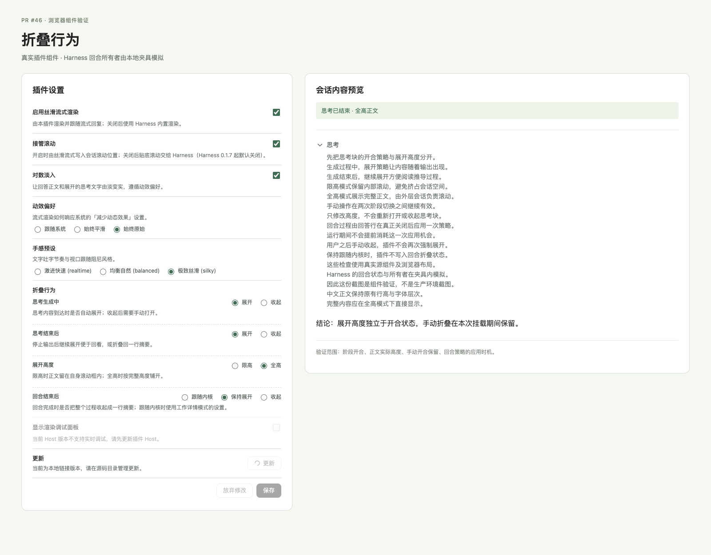

# PR #46 折叠行为验证

日期：2026-10-28。对照主分支 `00e4434`，PR 原始提交 `9560d12`。

## 审查与补充修正

- 设置字段已贯通 Host schema、RPC、客户端解析、配置卡片与渲染器；构建中的浏览器依赖纯度检查通过。
- 两个 Tooltip 测试原本只派发 pointer 事件，在当前 Harness 监听 mouse 事件时失败。按浏览器鼠标悬停顺序同时派发 pointer 与 mouse 事件，兼容两种实现。
- 构建产物设置页验证更新为四个折叠字段，并检查每组默认选中项。
- README 移除重复的旧折叠开关条目，说明旧配置升级、每个挂载回答行只应用一次及内核强制展开的边界。

## 自动验证

环境：Node.js 22.22.1、pnpm 11.23.0、Vitest 4.1.10。测试读取相邻 `../deepseek-harness` 源码，提交 `3a83e7e472`。

| 检查 | 结果 |
|---|---|
| TypeScript | 通过 |
| Host 与浏览器构建 | 通过 |
| 构建产物设置卡与插件页验证 | 9 项通过 |
| 主分支完整 Vitest | 286 通过，8 失败 |
| PR 原始完整 Vitest | 303 通过，10 失败 |
| Tooltip 修正后完整 Vitest | 305 通过，8 失败 |

8 项剩余失败与主分支的名称及断言数值一致，清单见 [已有验证记录](remaining-issues-2026-10-07.md#尚未通过的完整测试)。本次没有跳过测试或放宽断言，也没有证明这些历史失败全部无害。

工作树复用了已有依赖，命令关闭 pnpm 的运行前自动重装检查：

```sh
pnpm --config.verify-deps-before-run=false typecheck
pnpm --config.verify-deps-before-run=false test
pnpm --config.verify-deps-before-run=false build
node scripts/verify-plugins-page.mjs
```

## 浏览器组件验证

Chrome 156.0.8078.48，使用真实源组件及 CSS、减少动态效果模式。Harness 回合所有者和原语由本地夹具模拟；这次验证不等同于安装到完整 Harness 后的端到端测试。

7 项检查通过，页面和控制台错误均为 0：

- 生成中默认展开，停止后默认收起；结束阶段改为展开后正文可见。
- 限高时 `max-height: 300px`、`overflow-y: auto`，可视高度 300px、内容高度 360px。
- 全高时 `max-height: none`、`overflow-y: visible`，正文实际高度 360px。
- 仅改变高度保留手动展开状态。
- 回合关闭前不写入折叠状态，关闭后应用一次；后续手动折叠不被普通重渲染覆盖。
- 实际设置卡单选控件与保存按钮能应用所选配置。

截图为源组件验证页面，左侧设置卡与右侧正文使用真实组件：



## 保留的行为边界

- `thinkAutoExpand` 仍为接受历史配置的 volatile 字段，但不再影响渲染。原来设置为 false 的用户需要重新选择「思考生成中：收起」；没有自动迁移为新策略。
- 每个挂载回答行只应用一次回合策略。在该行已应用之后再改变策略，不会重新设置其开合。
- 回答行重挂载会再次应用策略，例如重新进入会话或重新启用插件。普通手动折叠由内核通过隐藏保留行，不会因此重新应用。
- 内核强制展开的回合仍受内核约束。含焦点的隐藏正文也可能被既有可访问性逻辑重新揭示。
